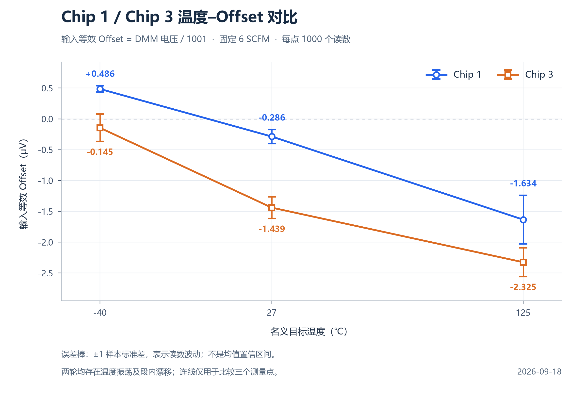

# Chip 1 / Chip 3 offset对比

使用2026-09-18两轮已核验的三温度结果，Gain=1001、6 SCFM、每点1000读数。均值及样本标准差直接读取输入等效统计值，不再除以增益。

横轴为名义目标温度；误差棒为±1样本标准差，并非均值置信区间。两轮都存在温度振荡和段内漂移，连线只用于比较三个测量点。

[矢量SVG](chip1_vs_chip3_offset_vs_temperature.svg) · [绘图数据及来源SHA-256](comparison_data.json) · [复现脚本](plot_comparison.py)

[Chip 1原始报告](../../../tasks/Offset_Chip_1_Gain1001_20260918/README.md) · [Chip 3原始报告](../../../tasks/Offset_Chip_3_Gain1001_20260918/README.md)
