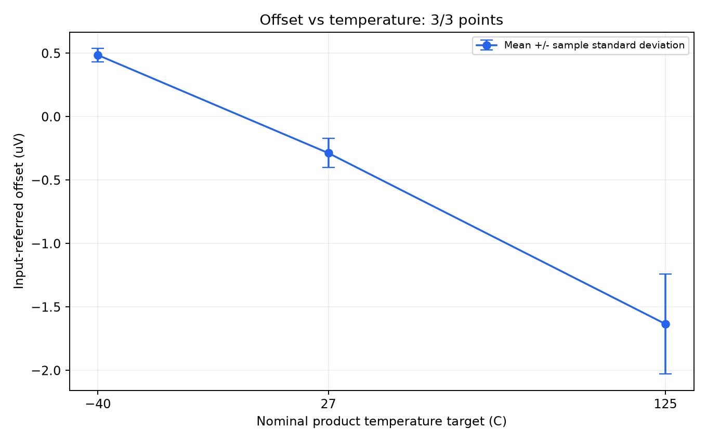

# Chip 1 三温度 offset 实机测试记录

2026-09-18 19:59:59–20:52:25（Asia/Shanghai），完成 −40℃ → 27℃ → 125℃，各1000个有效读数，共3000点。主进程退出码 0，三个DMM子进程退出码均为0，数据回读和完成标志检查通过。

热流仪已停止；20:52:51 独立复查 C10=0、R107=60（6 SCFM），此时产品温度 88.1℃。

**完成的是固定等待时间下的采集流程。三个温度点均存在温度振荡，不能视为持续±1℃稳定性通过。**

## 条件及执行规则

- 芯片：Chip 1；实际增益：1001 V/V，由用户确认。供电、trim等未提供条件不作推测。
- 任务标签：`Offset_Chip_1_Gain1001_20260918`。
- 产品控温；目标−40、27、125℃。每点首次进入目标±1℃后固定等待300秒，后续越界不重置计时、不自动重测。
- 固定流量设定6 SCFM：启动前和停止后均读回60；本次脚本没有写入R107。逐秒保存流量原始反馈，不能将起止读回描述为设定值的逐秒验证。
- DMM7510：`USB0::0x05E6::0x7510::04476049::INSTR`，前端子、固定100 mV、10 NPLC、AUTO高输入阻抗。
- Auto Zero及50 Hz同步开启；自动量程、内部平均、REL关闭。每段独立进程配置并读回；等待2秒，丢弃3读数，再保存1000点。
- 温度和通信持续记录；通信错误、无效/超量程读数、配置或完成标志不匹配、采集超时均按入口规则中止并尝试停机。本轮没有触发中止。

## 测量结果

原始TDMS保存DMM输出电压；输入等效offset=输出电压/1001，仅除一次。标准差采用样本标准差（ddof=1），不是均值置信区间或纯随机噪声。

| 目标温度 | 点数 | 输出均值(mV) | 输入offset均值(µV) | 输入标准差(µV) | 输入峰峰值(µV) | 采集实际产品温度范围 | 超出±1℃的温度样本 |
| --- | ---: | ---: | ---: | ---: | ---: | --- | --- |
| -40℃ | 1000 | +0.486291 | +0.485805 | 0.052543 | 0.318642 | -41.5～-37.9℃ | 363/659（55.08%） |
| 27℃ | 1000 | -0.286744 | -0.286457 | 0.114693 | 0.631091 | 24.8～29.7℃ | 455/659（69.04%） |
| 125℃ | 1000 | -1.635285 | -1.633651 | 0.394586 | 1.847304 | 120.6～127.6℃ | 513/660（77.73%） |

三个名义温度点与各点输入等效均值的最小二乘直线斜率为 **-12.911488 nV/℃**。
该斜率是本次顺序测试的描述性拟合，受到温度振荡和读数随时间变化的影响，不能直接作为稳定控温下的器件温漂规格。
实际温度统计只使用第一和最后一个有效DMM读数时间戳之间的温度样本，不插值补齐空隙。

| 目标温度 | 实际温度均值 | 采集首100点输入均值(µV) | 末100点输入均值(µV) | 末段−首段(µV) | 温度最大采样间隔 |
| --- | ---: | ---: | ---: | ---: | ---: |
| -40℃ | -39.5522℃ | +0.540339 | +0.436812 | -0.103528 | 1.035 s |
| 27℃ | 27.2030℃ | -0.384664 | -0.212527 | +0.172138 | 1.052 s |
| 125℃ | 124.0583℃ | -2.168559 | -1.289615 | +0.878944 | 1.039 s |

首尾100点比较用于描述段内变化；主结果仍使用全部1000点，没有筛选温度或删除越界期间的读数。



## 时序及核验

| 目标 | 首次到温耗时 | 固定等待 | 有效采集开始 | 有效采集结束 | 有效采集跨度 |
| --- | ---: | ---: | --- | --- | ---: |
| -40℃ | 129.297 s | 300.094 s | 20:07:19 | 20:18:19 | 660.118 s |
| 27℃ | 25.156 s | 300.094 s | 20:23:56 | 20:34:56 | 659.820 s |
| 125℃ | 75.125 s | 300.094 s | 20:41:22 | 20:52:22 | 660.172 s |

总流程 3146.109 秒，共 3149 条温度记录。主通信记录 56809 次请求，失败 0 次。
独立数据核验共 46 项全部通过，涵盖三个TDMS的float64读数、1000点数量、增益、逐点CSV一致性、请求SHA-256、完成标志、配置一致性、进程退出码、执行代码快照和最终停机/流量。
实机启动前沿用已完成的11项离线联动测试；本轮未修改联动接口。

## 文件

- [总运行记录](summary.json)、[输入offset汇总](offset_drift_summary.json)、[三点汇总CSV](offset_vs_temperature.csv)。
- [逐秒温度CSV](temperature.csv)、[温度曲线](temperature_curve.png)、[Modbus原始通信](wire.jsonl)、[事件记录](events.jsonl)。
- [独立数据核验](saved_data_verification.json)、[通信统计](communication_verification.json)、[停机及流量复查](postflight.json)、[主进程结果](process_result.json)。
- [启动复查](preflight.json)、[执行环境](execution_context.json)、[代码快照](code_snapshot)。

- -40℃：[原始TDMS](dmm/stage_01/data/Offset_Chip_1_Gain1001_20260918/Offset_Chip_1_Gain1001_20260918_dcv_0001.tdms)；[逐点CSV](dmm/stage_01/results/Offset_Chip_1_Gain1001_20260918/Offset_Chip_1_Gain1001_20260918_dcv_readings.csv)；[读数图](dmm/stage_01/results/Offset_Chip_1_Gain1001_20260918/Offset_Chip_1_Gain1001_20260918_dcv_offset.png)；[统计JSON](dmm/stage_01/results/Offset_Chip_1_Gain1001_20260918/Offset_Chip_1_Gain1001_20260918_dcv_offset_summary.json)；[DMM日志](dmm/stage_01/worker.log)。
- 27℃：[原始TDMS](dmm/stage_02/data/Offset_Chip_1_Gain1001_20260918/Offset_Chip_1_Gain1001_20260918_dcv_0001.tdms)；[逐点CSV](dmm/stage_02/results/Offset_Chip_1_Gain1001_20260918/Offset_Chip_1_Gain1001_20260918_dcv_readings.csv)；[读数图](dmm/stage_02/results/Offset_Chip_1_Gain1001_20260918/Offset_Chip_1_Gain1001_20260918_dcv_offset.png)；[统计JSON](dmm/stage_02/results/Offset_Chip_1_Gain1001_20260918/Offset_Chip_1_Gain1001_20260918_dcv_offset_summary.json)；[DMM日志](dmm/stage_02/worker.log)。
- 125℃：[原始TDMS](dmm/stage_03/data/Offset_Chip_1_Gain1001_20260918/Offset_Chip_1_Gain1001_20260918_dcv_0001.tdms)；[逐点CSV](dmm/stage_03/results/Offset_Chip_1_Gain1001_20260918/Offset_Chip_1_Gain1001_20260918_dcv_readings.csv)；[读数图](dmm/stage_03/results/Offset_Chip_1_Gain1001_20260918/Offset_Chip_1_Gain1001_20260918_dcv_offset.png)；[统计JSON](dmm/stage_03/results/Offset_Chip_1_Gain1001_20260918/Offset_Chip_1_Gain1001_20260918_dcv_offset_summary.json)；[DMM日志](dmm/stage_03/worker.log)。

## 复现

基线Git HEAD：`cf8392c5596ba0148129a1b4b17137bf5347915e`。工作区存在未提交修改；实际运行版本以`code_snapshot`和`summary.json`中的SHA-256为准。

本次实机命令如下。重跑会再次操作硬件，必须使用新的运行目录；本轮没有自动续测或重测。

```powershell
& 'C:\Users\jinge\Envs\ni-scope-2023q4\Scripts\python.exe' -u .\scripts\thermal_stream_offset_drift.py --task-id Offset_Chip_1_Gain1001_20260918 --readings 1000 --gain 1001 --dmm-resource 'USB0::0x05E6::0x7510::04476049::INSTR' --terminals FRONT --dmm-range 0.1 --nplc 10 --host 192.168.1.50 --port 3000 --unit-id 0 --interval 1 --tolerance 1 --hold-seconds 300 --output-dir .\results\offset_drift\chip1_gain1001_20260918_run01
```

目录内 `verify_saved_data.py` 和 `write_report.py` 仅处理本地已保存文件，不连接仪器。
