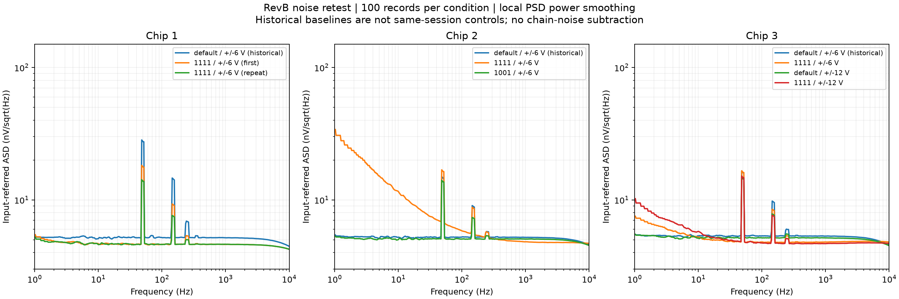

# 2026-09-18 - T-20260817-01 - RevB trim 电流与供电条件补充噪声测试

> 2026-10-12 整理说明：用户确认本报告保留的测试由项目负责人本人执行；旧委托安排不作为当前保留成果的执行人或完成状态依据。
> 测试方法、历史数值与异常记录保持；文中的当日待办不自动代表当前状态。现用路径已更新；旧版原文由用户另行备份，仓库中的基线快照已删除。

## 结论摘要

2026-09-17 至 09-18 新增 7 组 RevB（with PMU）噪声测试，每组 100 份、每份 22 s，合计 700 份 TDMS、770,000,000 个样本。三颗芯片均测试了最大 Gmx trim；另有 Chip 3 的 ±12 V 条件、Chip 2 的 `4'b1001` 条件和 Chip 1 的满电流重复测试。

**用户于 2026-09-18 确认：`Gmx_max` 对应 `4'b1111`；Chip 1 单独标为 `Gmx_4b1111` 的数据是相同设置的重复测试。** 两组保留原 task-id，分别报告，没有合并平均。各码对应的实际电流尚未记录。

主指标均为先平均 PSD，再在目标附近频带平均功率并开方得到的输入等效 ASD，单位 `nV/√Hz`。

| ID | 芯片 | Gmx 标签 / 控制码 | 供电 | 1 Hz ASD | 1 kHz ASD | 1 Hz / 1 kHz 逐次 CV |
| --- | --- | --- | --- | ---: | ---: | ---: |
| N1 | Chip 1 | max / `1111` | ±6 V | 5.459820 | 4.606908 | 10.841% / 1.240% |
| N2 | Chip 2 | max / `1111` | ±6 V | 34.046842 | 4.824876 | 11.776% / 1.224% |
| N3 | Chip 3 | max / `1111` | ±6 V | 7.539210 | 4.805537 | 12.013% / 1.127% |
| N4 | Chip 3 | default / `0110` | ±12 V | 5.503148 | 5.163840 | 11.579% / 1.022% |
| N5 | Chip 3 | max / `1111` | ±12 V | 10.217371 | 4.670100 | 12.095% / 1.053% |
| N6 | Chip 2 | `4b1001` / `1001` | ±6 V | 5.319221 | 5.058863 | 10.647% / 1.062% |
| N7 | Chip 1 | `4b1111` / `1111`，重复 | ±6 V | 5.234280 | 4.621788 | 11.192% / 1.155% |

主要发现：

- 相对各自历史 default / ±6 V，三颗芯片满电流的 1 kHz ASD 分别降低 **10.963%、7.405%、9.766%**。历史基线与本批跨日期，不将这些差值全部归因为电流变化。
- 低频没有一致改善。Chip 2 满电流的 1 Hz ASD 为 **34.047 nV/√Hz**，约为其历史 default 的 **6.263 倍**；100 次的最小值仍为 **23.923 nV/√Hz**，不是单次极端值拉高平均。前 50 次与后 50 次分别平均 PSD 后的 1 Hz ASD 为 **33.914 / 34.180 nV/√Hz**，升高贯穿整组。Chip 2 改为 `1001` 后测得 **5.319 nV/√Hz**，同时 1 kHz 从 4.825 升至 5.059 nV/√Hz。
- Chip 1 同码复测的 1 kHz 从 **4.606908** 变为 **4.621788 nV/√Hz**（+0.323%），1 Hz 变化 −4.131%。这支持该样片本次 1 kHz 结果的重复性；不等同于完整测量不确定度。
- Chip 3 在 `1111` 下由 ±6 V 改为 ±12 V，1 kHz 降低 **2.818%**，1 Hz 升高 **35.523%**。±12 V 下从 default 改为 `1111`，1 kHz 降低 **9.561%**，1 Hz 升高 **85.664%**。此次更大偏置与更高供电没有带来全频段一致收益。

数据及计算一致性检查见“验证记录”。本记录不做器件本征噪声规格 Pass/Fail：测量包含反馈网络、夹具和采集链贡献，且没有同期回切 default 的完整 A-B-A 控制。

## 测试条件与可追溯信息

- 关联任务：`T-20260817-01`，DUT 噪声测试的后续扩展；原安排的 ±3 V / 外置 PMU 与本次 RevB / ±6 V、±12 V 分别记录。
- 测试日期：北京时间 2026-09-17 23:25 至 2026-09-18 14:28。
- 实际执行人：项目负责人本人（用户于 2026-10-12 确认）。
- 代码基线：`a232d2c`；本记录与结果的归档 commit 以包含此文件的 Git 提交为准。复核 JSON 同时保存完整基线哈希和分析代码 SHA-256。
- 环境：Windows、64 位 CPython 3.11.9；虚拟环境 `C:\Users\jinge\Envs\ni-scope-2023q4`。Python 包实际版本见复核 JSON。
- MATLAB 版本：不适用，本批采用 Python Welch 流程。
- DUT：RevB with PMU，Chip 1、2、3；task-id 标记有屏蔽罩、OSC default。
- Gmx default 码 `0110` 来自项目 README；`max = 1111` 来自本次用户确认；`1001` 来自 task-id。未从 DUT 独立回读寄存器。
- 实测 Gmx 电流、各路电源电流、环境 / 芯片温度、换设置后的稳定等待时间、OSC 实际频率、接线是否重新插拔：`<TBD>`。
- 供电 ±6 V / ±12 V 依据 task-id；独立电压实测记录：`<TBD>`。

新增七组从 TDMS 核对的公共采集配置：

| 项目 | 实际记录 |
| --- | --- |
| 设备 | NI PXI-5922，序列号 `2094935` |
| NI-SCOPE 驱动 | 23.8.0（2023 Q4） |
| 资源名 / 通道 | `PXI1Slot2_2` / CH0 |
| 采样率 / 点数 | 50,000 Sa/s / 1,100,000 点 |
| 每份时长 / dtype | 22 s / float64 |
| 阻抗 / 量程 / 耦合 | 1 MΩ / 2 Vpp / DC |
| 触发 / 带宽配置 | Immediate / `max_input_frequency_hz = -1.0` |
| 标称噪声增益 | 1001 V/V |
| GBW / 闭环带宽元数据 | 15 MHz / 14,985.015 Hz |

GBW 和闭环带宽是采集脚本写入的估计值，没有在每个 trim 条件重新标定，不能据此认定满电流后的真实带宽仍为 15 kHz。输入等效 PSD 按标称增益 1001 的平方归一化，没有进行频率响应反卷积。

## 原始数据与运行记录

所有正式组均为 TDMS `0001–0100` 和 NPZ `0001–0100`。下表时间取 TDMS 的 UTC 时间戳转换为北京时间，结束时间为最后一份记录起始时间加 22 s，未包含之后的写盘 / 绘图时间。

| ID | 北京时间开始 | 北京时间结束 | 原始字节数 |
| --- | --- | --- | ---: |
| N1 | 09-17 23:25:52 | 09-18 00:02:37 | 880,196,300 |
| N2 | 09-18 00:04:00 | 09-18 00:40:45 | 880,196,300 |
| N3 | 09-18 00:41:46 | 09-18 01:18:31 | 880,196,300 |
| N4 | 09-18 09:34:14 | 09-18 10:10:59 | 880,196,800 |
| N5 | 09-18 10:19:45 | 09-18 10:56:31 | 880,196,400 |
| N6 | 09-18 11:10:54 | 09-18 11:47:39 | 880,196,600 |
| N7 | 09-18 13:51:33 | 09-18 14:28:18 | 880,196,600 |

task-id 与已归档结果目录：

| ID | task-id / 结果目录 |
| --- | --- |
| N1 | [RevB_Chip_1_wiShield_Gmx_max_OSC_default_Vsup_pm6V](../../../../Unicorn_CSA_RevB-COB/tasks/RevB_Chip_1_wiShield_Gmx_max_OSC_default_Vsup_pm6V/results/) |
| N2 | [RevB_Chip_2_wiShield_Gmx_max_OSC_default_Vsup_pm6V](../../../../Unicorn_CSA_RevB-COB/tasks/RevB_Chip_2_wiShield_Gmx_max_OSC_default_Vsup_pm6V/results/) |
| N3 | [RevB_Chip_3_wiShield_Gmx_max_OSC_default_Vsup_pm6V](../../../../Unicorn_CSA_RevB-COB/tasks/RevB_Chip_3_wiShield_Gmx_max_OSC_default_Vsup_pm6V/results/) |
| N4 | [RevB_Chip_3_wiShield_Gmx_default_OSC_default_Vsup_pm12V](../../../../Unicorn_CSA_RevB-COB/tasks/RevB_Chip_3_wiShield_Gmx_default_OSC_default_Vsup_pm12V/results/) |
| N5 | [RevB_Chip_3_wiShield_Gmx_max_OSC_default_Vsup_pm12V](../../../../Unicorn_CSA_RevB-COB/tasks/RevB_Chip_3_wiShield_Gmx_max_OSC_default_Vsup_pm12V/results/) |
| N6 | [RevB_Chip_2_wiShield_Gmx_4b1001_OSC_default_Vsup_pm6V](../../../../Unicorn_CSA_RevB-COB/tasks/RevB_Chip_2_wiShield_Gmx_4b1001_OSC_default_Vsup_pm6V/results/) |
| N7 | [RevB_Chip_1_wiShield_Gmx_4b1111_OSC_default_Vsup_pm6V](../../../../Unicorn_CSA_RevB-COB/tasks/RevB_Chip_1_wiShield_Gmx_4b1111_OSC_default_Vsup_pm6V/results/) |

每组提交平均谱 PNG、逐次分布 PNG、逐次目标值 CSV、JSON 摘要共四个文件。原始 TDMS 在本机 `Unicorn_CSA_RevB-COB/tasks/<task-id>/data/`；逐次 NPZ 在 `Unicorn_CSA_RevB-COB/tasks/<task-id>/spectra/`。二者按仓库规则不入 Git。可访问的原始数据外部链接和权限：`<TBD>`。

## 与历史基线及同批条件对比

三组历史基线均采用相同的 default / `0110`、±6 V、100 次、增益 1001 和 Welch 设置：

| ID | 芯片 | 1 Hz ASD | 1 kHz ASD |
| --- | --- | ---: | ---: |
| H1 | Chip 1 | 5.253586 | 5.174125 |
| H2 | Chip 2 | 5.435875 | 5.210722 |
| H3 | Chip 3 | 5.459185 | 5.325620 |

完整 task-id 为 `RevB_Chip_<芯片编号>_wiShield_Gmx_default_OSC_default_Vsup_pm6V`。基线数据也纳入本次原始波形复算，具体采集时间、仪器资源名和统计范围见复核 JSON。跨日期对比可能混有温度、接线及时间漂移；本次没有相关同步记录用于扣除。

| 对比方向（后者相对前者） | 1 Hz ASD 变化 | 1 kHz ASD 变化 |
| --- | ---: | ---: |
| H1 → N1：Chip 1 default → 1111 | +3.926% | −10.963% |
| H2 → N2：Chip 2 default → 1111 | +526.336% | −7.405% |
| H3 → N3：Chip 3 default → 1111 | +38.101% | −9.766% |
| N1 → N7：Chip 1 同码重复 | −4.131% | +0.323% |
| N2 → N6：Chip 2 1111 → 1001 | −84.377% | +4.850% |
| H3 → N4：Chip 3 default，±6 V → ±12 V | +0.805% | −3.038% |
| N3 → N5：Chip 3 1111，±6 V → ±12 V | +35.523% | −2.818% |
| N4 → N5：Chip 3 ±12 V，default → 1111 | +85.664% | −9.561% |



此图保留原有局部功率平滑定义，展示 1 Hz–10 kHz；窄带峰不会被剔除。全部频谱与逐次分布见各组原始 PNG。

## 分析方法与验证记录

Welch：Hann 窗，`nperseg=262144`，50% 重叠，constant detrend，单边 PSD，`scaling="density"`，mean averaging。50 kSa/s 下每段 5.24288 s、频率分辨率约 0.190735 Hz，每份 22 s 记录贡献 7 段。

计算顺序：`输入 PSD = 输出 PSD / 1001²`；100 份记录的 PSD 等权平均。目标值使用 1/6 倍频程全宽、至少 5 个 bin 的局部功率平均，再开方转为 `nV/√Hz`：

- “1 Hz”实际取 **0.572205–1.335144 Hz** 的 5 个 bin；不是精确 1 Hz 单 bin。
- “1 kHz”实际取 **943.946838–1059.341431 Hz** 的 606 个 bin。
- CV 是 100 个逐次局部 ASD 的样本标准差 / 算术平均值。主表是先平均 PSD 再开方，不是逐次 ASD 的算术平均。
- 没有扣除仪器基线或反馈网络热噪声；结果代表总输入等效噪声。默认设置也不用于宣称 0.1 Hz 噪声。

本次使用[独立复核入口](../../../../Unicorn_CSA_RevB-COB/results/noise_retest_20260918/verify_and_summarize.py)，读取已有文件，复用正式分析函数，检查内容如下：

1. 七组新增及三组历史基线共 **1,000 份 TDMS** 的 task-id、编号、float64、点数、有限值、采样率、增益及组内配置一致性。
2. 全部原始波形重新计算 DC 均值、AC RMS、峰峰值、近削顶标志，并与记录的元数据核对。
3. 全部 **1,000 份波形重算 Welch PSD**，逐频点与现有 NPZ 比较；并检查任务、run、源文件名、Welch 参数、采样率、频率轴及带宽元数据。
4. 核对全部目标值 CSV、JSON 主指标及逐次分布统计；数值容差 `rtol=1e-10, atol=0`。
5. 为全部 1,000 份 TDMS 记录 SHA-256 和字节数；检查 `0001–0100` 连续且没有残留 partial 文件。

复核结果以[verification_summary.json](../../../../Unicorn_CSA_RevB-COB/results/noise_retest_20260918/verification_summary.json)为准。报告生成时全部检查通过；全部 1,000 份重算 PSD 与原 NPZ 的最大相对误差为 **0**，新增 700 份和历史 300 份均无近削顶记录。新增原始文件总计 **6,161,375,300 B**，SHA-256 清单同时包含三组历史基线。该核对确认文件与计算可复现，不验证硬件接线、实测电流或完整噪声模型。

相关产物：

- [十条件数值汇总 CSV](../../../../Unicorn_CSA_RevB-COB/results/noise_retest_20260918/condition_summary.csv)
- [原始文件 SHA-256 清单](../../../../Unicorn_CSA_RevB-COB/results/noise_retest_20260918/raw_file_manifest.csv)
- [复核环境、代码哈希、时间和统计 JSON](../../../../Unicorn_CSA_RevB-COB/results/noise_retest_20260918/verification_summary.json)

从仓库根目录重新执行全部复核（需要本机原始数据和逐次 NPZ）：

```powershell
python .\Unicorn_CSA_RevB-COB\results\noise_retest_20260918\verify_and_summarize.py
```

复核入口只更新本汇总目录下的派生结果。若需从 TDMS 重建某组缺失的逐次频谱并绘图，可用正式离线入口：

```powershell
$taskId = 'RevB_Chip_2_wiShield_Gmx_max_OSC_default_Vsup_pm6V'
python .\Unicorn_CSA_RevB-COB\postprocess\process_tasks.py --task-id $taskId
```

本批采集参数的当前入口等价命令如下，仅作配置记录，**不是本次复核所运行的命令**。
现场另建 `$newTaskId` 记录重复实验；迁移历史 task 没有现场入口保存的续测配置时不能直接复用。

```powershell
$newTaskId = 'RevB_Chip_2_wiShield_Gmx_max_OSC_default_Vsup_pm6V_REPEAT'
python .\Unicorn_CSA_RevB-COB\field\capture_noise.py --task-id $newTaskId --chip 2 --resource PXI1Slot2_2 --channel 0 --runs 100 --sample-rate 50000 --samples 1100000 --input-impedance 1000000 --vertical-range 2 --gain 1001 --gbw 15000000 --dry-run
```

## 后续事项

- 优先对 Chip 2 做 `0110 → 1001 → 1111 → 1001` 的同期回切测试，保留温度、电流和等待时间记录，确认低频升高是否随 trim 可逆变化。
- Chip 3 在 ±6 V / ±12 V 下复测同一码，区分供电、温升和测试顺序影响；目前只能描述观察到的差异。
- 补齐各码实测电流、OSC 频率、实际增益 / 带宽和原始数据共享链接。
- 以上是本批测量后的建议；当前未排期事项统一见[测试安排](../../../../测试安排.md#待安排事项)。

## 2026-10-12 当前目录与状态补充

本记录中的测试条件与历史数值保持。原始数据/频谱/结果已合并到每个task目录；
当前复现入口见[离线后处理](../../../../Unicorn_CSA_RevB-COB/postprocess/README.md)，
执行 `python Unicorn_CSA_RevB-COB/postprocess/process_tasks.py --all`。
当前共保留 13 组（含 Chip 5 default），见[完整任务索引](../../../../Unicorn_CSA_RevB-COB/tasks/README.md)。
全部 13 组原始文件 SHA-256 已绑定各 `task.json`；外部共享位置仍待完善。
上文现用命令已更新为新入口，历史命令原文保留在基线快照；新的[Windows 现场入口](../../../../Unicorn_CSA_RevB-COB/field/README.md)默认只采集。
