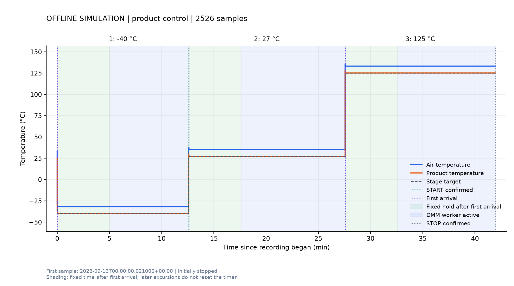
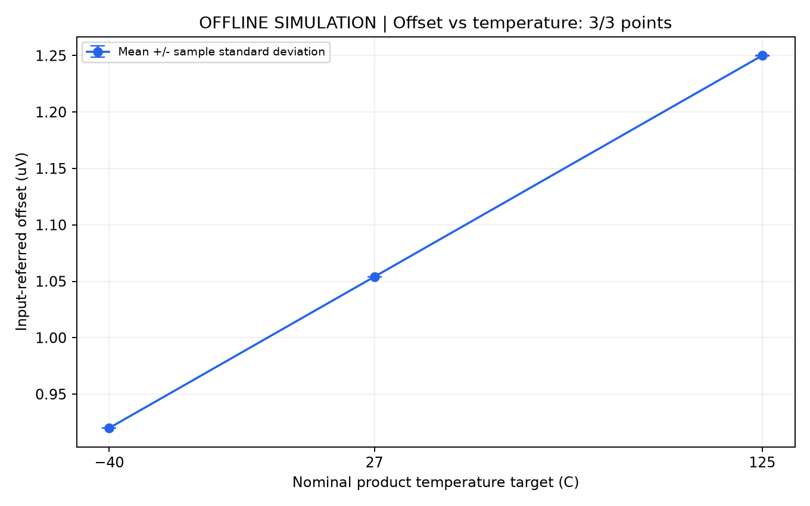

# 三温度 offset drift 联动：离线验证通过

**本目录全部温度和 DMM 读数均为模拟数据，未连接或操作真实仪器。**
用途是核对两进程握手、计时、采样数量、结果保存和分析。时间模型不代表真实温变或采集速度，
统计值不属于真实 DUT 的 offset drift 测量结果。

## 验证结果

- 34 项自动测试通过，包括原热流仪 26 项回归及新增联动测试。
- 三个目标 −40℃、27℃、125℃各首次到温后等待 300 秒，再启动独立 DMM 模拟进程。
- 每阶段的 DMM 采集和 TDMS 回读均为 1000 个有效点，增益 1001，共 3000 点；另有每点 3 次丢弃读数。
- DMM 活动期间热流仪持续运行、采温，只有正确的完成 flag 和子进程退出码 0 才触发下一温度。
- 三次握手和最终模拟停机均确认；2526 个温度样本，45588 次模拟 Modbus 请求无失败。
- [逐项产物检查](validation_checks.json)验证三个任务 ID 独立、请求摘要匹配、点数一致、动作顺序正确和模拟 VISA 资源关闭。
- 汇总程序恢复出模拟模型预设的 2 nV/℃线性系数，仅用于检验计算链路。

| 阶段 | 目标 | 计时完成时的等待秒数 | DMM 有效点数 | 增益 | 完成标志 |
| --- | --- | --- | --- | --- | --- |
| 1 | −40℃ | 300.018 | 1000 | 1001 | completed，退出码 0 |
| 2 | 27℃ | 300.000 | 1000 | 1001 | completed，退出码 0 |
| 3 | 125℃ | 300.000 | 1000 | 1001 | completed，退出码 0 |

全流程温度时间采用虚拟时钟，DMM 测量使用模拟查询时间；进程启动、磁盘 I/O 和绘图仍实际执行。
因此各 DMM 子进程区间的虚拟长度不可用于推算实际测量耗时。

## 复现

在项目根目录使用已包含分析依赖的环境运行：

```powershell
& 'C:\Users\jinge\Envs\ni-scope-2023q4\Scripts\python.exe' -m unittest discover -s scripts -p 'test_*.py' -v
& 'C:\Users\jinge\Envs\ni-scope-2023q4\Scripts\python.exe' .\scripts\validate_offset_drift_offline.py --readings 1000 --output-dir .\results\offset_drift\new_offline_run
```

使用新目录，避免覆盖本记录。环境为 Python 3.11.9、PyVISA 1.16.2、npTDMS 1.11.0、
NumPy 2.4.6、SciPy 1.17.1、Matplotlib 3.11.1。
本次运行源代码及 SHA-256 保存在 `code_snapshot/` 和 [summary.json](summary.json)；核对时与当前源文件一致。

## 记录索引

- [温度 CSV](temperature.csv)、[通信报文](wire.jsonl)、[流程事件](events.jsonl)、[运行摘要](summary.json)。
- 阶段完成 flag：[−40℃](dmm/stage_01/dmm_done.json)、[27℃](dmm/stage_02/dmm_done.json)、[125℃](dmm/stage_03/dmm_done.json)。
- 每点 DMM CSV：[−40℃](dmm/stage_01/results/offset/offset_dcv_readings.csv)、[27℃](dmm/stage_02/results/offset/offset_dcv_readings.csv)、[125℃](dmm/stage_03/results/offset/offset_dcv_readings.csv)。
- [offset–温度汇总 CSV](offset_vs_temperature.csv)、[分析摘要](offset_drift_summary.json)。
- [使用与信号协议说明](../../../scripts/thermal_stream_offset_drift.md)。




