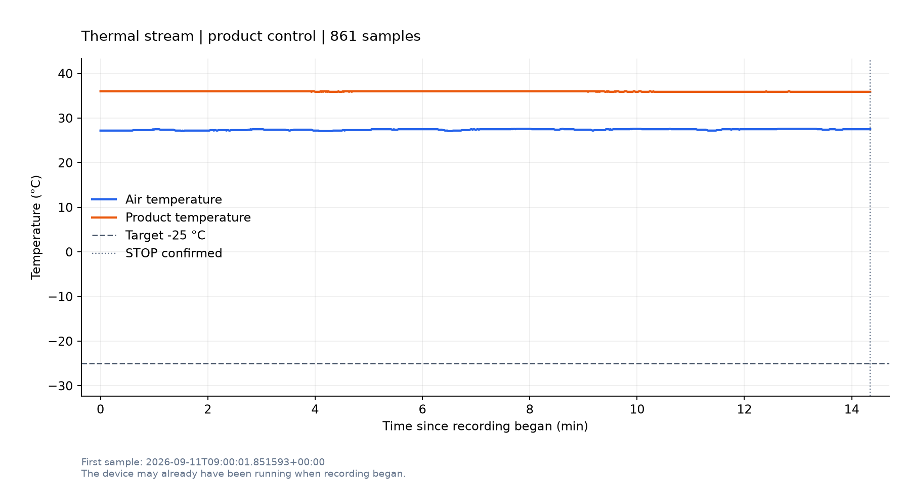

# -25℃ 控温尝试记录

本次已按用户要求提前结束，停止命令收到正常回显，运行状态 C10 读回为 0。未达到 -25℃。

- 记录时间：2026-09-11 17:00:01 至 17:14:22（Asia/Shanghai），共 860.7 秒、861 个样本。
- 通信入口：192.168.1.50:3000，Modbus TCP，Unit ID 0。
- 控温对象：沿用设备原有的产品温度控制；定值、低温、不定时。
- 判据：目标 ±0.5℃ 连续 60 秒；原定上限 1200 秒，本次由用户提前结束。
- 空气温度：27.2 → 27.5℃；全程范围 27.1～27.6℃。
- 产品温度：36.0 → 35.9℃；全程范围 35.9～36.0℃。
- 目标读回保持 -25.0℃；未进入稳定温差带，未观察到有效降温。记录中的协议失败请求数为 0。

## 实际控制与结论边界

脚本接入时设备已经运行，低温目标已经是 -25℃，因此本次接续已有运行。
脚本重新写入 R105 = 0xFF06 并读回确认；未发送启动 C0，未切换模式、流量或温度斜率。
结束时发送停止 C1，并在随后读取中确认 C10 = 0。停止后的末次温度样本亦包含在 CSV 中。

协议写入与读取成功不代表制冷过程成功。本次记录不能确定未降温的设备侧原因，
也没有验证从停止状态启动、模式切换或产品实际达到目标温度。
时间原点为开始记录，无法恢复此前尚未采集的设备温度过程。

## 文件

- [逐秒温度数据](temperature.csv)
- [温度曲线](temperature_curve.png)
- [运行摘要](summary.json) 与 [统计及写入证据](analysis_summary.json)
- [原始收发报文](wire.jsonl) 与 [事件记录](events.jsonl)
- [本次执行脚本快照](script_snapshot.py) 与 [执行环境及 SHA256](execution_context.json)
- [当前脚本使用说明](../../../scripts/thermal_stream_temperature_run.md)

本次执行快照保持原样。当前工作脚本随后补充了事件日志写盘异常不影响停止确认的处理，
其离线测试共 9 项通过；此修改没有改变已经运行中的本次程序。

