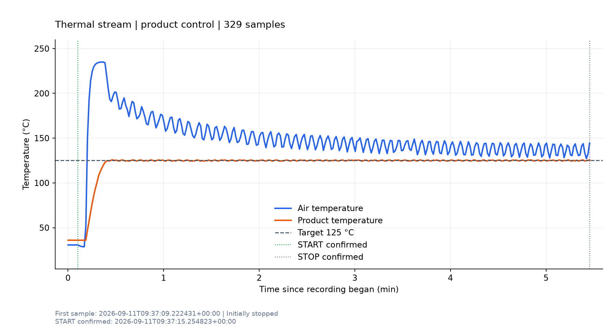

# 125℃高温控制与温度记录

2026-09-11，PC 经 `192.168.1.50:3000`、Modbus TCP、Unit ID 0 控制热流仪。
本次已确认设备能够加热，产品温度通道从 36.0℃升至 125℃附近。
按后来放宽的 **125℃ ±1℃、持续 60 秒** 对已采集数据复核，结果通过。

共记录 **327.469 秒、329 个样本**。结束前连续 60.031 秒的 61 个运行样本为
**124.3～125.6℃，平均 125.013℃，最大绝对偏差 0.7℃**。
原来 ±0.5℃条件下最长连续带内时间仅 13 秒；它未满足原判据，不代表加热失效。

## 时间与状态

下表时间为 Asia/Shanghai（UTC+8）。原始文件使用 UTC。

| 事件 | 时间 | 说明 |
| --- | --- | --- |
| 开始记录 | 17:37:09 | 设备停止；空气 30.7℃，产品 36.0℃；沿用产品控温 |
| 高温目标及模式确认 | 17:37:14 | R103=125℃，C16=0、C14=1；定值、不定时 |
| 启动确认 | 17:37:15.255 | 发送 C0 后读回 C10=1 |
| 首次进入 ±1℃范围 | 17:37:33.368 | 产品 124.5℃，距启动确认约 18.1 秒 |
| 复核首次满足 ±1℃持续 60 秒 | 17:38:33.399 | 根据保存的样本事后计算，未据此改变当时运行行为 |
| 高温记录结束并确认停止 | 17:42:36 | 读到 C10=0，脚本结束；最终产品 125.3℃ |
| 后续只读检查 | 17:43:10 | 已切换为低温运行；用户确认是其面板操作 |

本次高温记录未发送 C1 停止命令：采样先观察到设备停止，清理流程再读取 C10 确认。
随后用户在面板切换并启动低温模式，助手保留该运行状态，没有将其作为高温试验重新接管。

## 温度过程



125℃目标针对产品反馈通道。空气通道本次最高读到 **235.0℃**，启动后逐渐回落并波动，
不能把产品目标解释为空气通道也限定在 125℃。产品通道全程最高为 125.7℃。
进入 ±1℃范围后，运行样本连续位于该范围内约 **302.093 秒**。

末尾复核窗口为 17:41:35.435 至 17:42:35.471，共 61 个运行样本，最大相邻间隔 1.016 秒。
只采用设备运行、产品控温、高温模式、目标读回 125℃且非除霜、非整定的记录。
稳定性是对约 1 Hz 的设备读值判定，未独立验证两次采样之间的温度或传感器准确度。

## 实际控制与通信证据

| 写入动作 | 请求及正常响应十六进制字节 | 读回结果 |
| --- | --- | --- |
| R103 设为 125℃ | `00 00 00 00 00 06 00 06 00 67 04 E2` | R103=125℃；该预设原本也是 125℃ |
| C16 关闭低温 | `00 00 00 00 00 06 00 05 00 10 00 00` | C16=0 |
| C14 打开高温 | `00 00 00 00 00 06 00 05 00 0E FF 00` | C14=1 |
| C0 启动 | `00 00 00 00 00 06 00 05 00 00 FF 00` | C10=1，随后观察到温升 |

上述四项是本次全部写请求。C17 高温标志和 C19 低温标志由设备自动变为 1、0，
没有直接写入标志位。控温对象、流量、温度上下限、斜率和除霜参数均沿用原值。
R126 斜率原始值保持 0，而此次实际升温成功；因此不能仅据该值断言设备无法升温。

共 **5983 次协议请求，失败 0 次**；采样间隔中位数 1 秒、最大约 1.11 秒。
本次所有已记录样本的除霜和整定状态均为 False。
该结果验证高温控制路径有效；此前低温未降温的原因仍待验证。用户目前判断冷却机未启动。

## 判据调整与可追溯记录

本次运行开始时使用 ±0.5℃。用户随后反馈要求过高，助手采用 ±1℃复核已有数据，
并将后续控制脚本的默认 `--tolerance` 改为 1.0。设备目标始终是 125℃；此容差属于 PC 的验收判据。

`temperature.csv` 中 `in_band`、`stable_for_s` 以及 `summary.json` 仍反映原始 ±0.5℃条件：
`status=device_stopped`、`target_reached=false`、`stop_confirmed=true`。
放宽后的通过结论保存在独立的 `evaluation_pm1c.json`，没有改写原始运行结果。

| 文件 | 内容 |
| --- | --- |
| [temperature.csv](temperature.csv) | 329 个原始温度及状态样本 |
| [temperature_curve.png](temperature_curve.png) | 完整温度过程及启动、停止确认位置 |
| [summary.json](summary.json) | 原始执行参数和结束状态，容差 0.5℃ |
| [evaluation_pm1c.json](evaluation_pm1c.json) | ±1℃复核、最后一分钟统计和源文件 SHA-256 |
| [analysis_summary.json](analysis_summary.json) | 温度范围、通信统计与全部写请求 |
| [events.jsonl](events.jsonl) / [wire.jsonl](wire.jsonl) | 事件及原始请求、响应报文 |
| [script_snapshot.py](script_snapshot.py) | 本次实际执行脚本快照，保留原容差默认值 |
| [execution_context.json](execution_context.json) | 命令、运行环境、分支与脚本 SHA-256 |
| [后续诊断](../diagnostics_20260911T094310_381109Z.json) | 用户已手动切换至低温运行的只读快照 |

后续按放宽判据运行：

```powershell
python .\scripts\thermal_stream_temperature_run.py --mode hot --target 125 --tolerance 1 --hold-seconds 60
```

高低温模式隔离、报文、配置异常和停止清理等 14 项离线测试通过。
