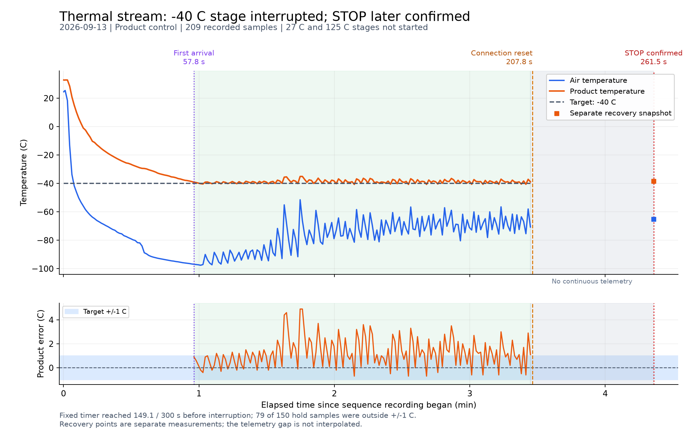

# 三阶段实机验证：低温阶段通信中断，后续已确认停机

日期：2026-09-13，以下时间为 Asia/Shanghai（UTC+8）。这是实际设备记录，不是离线模拟。

**完整三阶段验证未通过。** −40℃阶段已观察到降温并首次到温，但计时约 149 秒后 TCP 连接重置，
没有达到 300 秒，也没有开始 27℃和125℃阶段。原程序停止重连失败；随后独立重连，发送 STOP 并确认 C10=0。
没有自动重启、跳段或续接中断的计时。

## 现场与执行条件

- 用户已授权实机运行，并此前反馈低温问题与压缩机未启动有关；本次不控制压缩机电源。
- ASIX USB 网卡，MAC `08-26-AE-32-33-8C`，接口 5，100 Mbps。
- PC 临时地址 `192.168.1.200/24`，无网关；设备 `192.168.1.50:3000`，Modbus TCP，Unit ID 0。
- 产品控温、定值、不定时；流量设定读回 12.0 SCFM；温度斜率原始值 0。
- 预检查的温度配置范围 −100～235℃，除霜、整定均关闭，设备停止；其他参数沿用原值。
- 控制和绘图代码 SHA-256 与已完成离线验证的版本一致，快照见 `code_snapshot/`。
- 预检查见 [只读诊断](../diagnostics_20260913T052604_170140Z.json)；网络配置见
  [临时地址恢复记录](../ethernet_setup_20260913_ready.json)。

实际执行命令：

```powershell
& 'C:\Users\jinge\AppData\Local\Programs\Python\Python311\python.exe' .\scripts\thermal_stream_temperature_sequence.py --host 192.168.1.50 --port 3000 --unit-id 0 --interval 1 --tolerance 1 --hold-seconds 300 --output-dir .\results\thermal_stream\sequence_20260913_run01
```

## 逐阶段结果

规则为首次进入目标 ±1℃后固定计时 300 秒，越界不暂停或清零，等待到温不设超时。

| 阶段 | 目标 | 启动确认 | 首次到温 | 从启动到首次到温 | 已记录计时 | 结果 |
| --- | --- | --- | --- | --- | --- | --- |
| 低温 | −40℃ | 13:26:28.153 | 13:27:25.295，产品 −39.1℃ | 57.140 秒 | 149.063 / 300 秒 | 通信中断，未完成 |
| 常温 | 27℃ | — | — | — | — | 未开始 |
| 高温 | 125℃ | — | — | — | — | 未开始 |

记录从 13:26:27.497 开始，最后完整温度样本为 13:29:54.352，产品 −38.9℃、空气 −70.7℃，C10=1。
共 209 个完整温度样本，其中 207 个为启动后的采样，另有预检查和配置样本各 1 个。
运行采样平均间隔 1.000534 秒，最小 0.984 秒、最大 1.016 秒。

首次到温后的 150 个计时样本：

| 指标 | 实测值 |
| --- | --- |
| 产品温度范围 | −40.7～−35.1℃ |
| 产品温度均值 | −38.768℃ |
| 超出 −41～−39℃的样本数 | 79 / 150（52.7%） |
| 最后样本的累计计时 | 149.063 秒 |
| 全部原始样本的空气温度范围 | −97.6～25.4℃ |

越界比例为样本比例，不是连续时间占比。计时没有因为越界而重置；本次没有完成五分钟计时，
更不能将已记录时段描述为连续稳定在 ±1℃。通信空白期间没有连续温度数据。

## 通信中断和停止恢复

13:29:55.264，FC03 读取 R0 的请求遇到 `ConnectionResetError / WinError 10054`，没有收到响应字节。
主流程共记录 3802 次 Modbus 请求：3801 次成功，1 次连接重置失败。
随后两次建立 TCP 连接均超时；这些连接尝试没有形成 Modbus 请求，故不计入 3802 条报文。
13:30:01.282，主程序结束并保存 `status=error`、`sequence_completed=false`、`stop_confirmed=false`，退出码 1。

13:30:48 恢复连接后的独立停机过程：

| 时间 | 动作或状态 |
| --- | --- |
| 13:30:48.691 | C10=1，设备仍在运行 |
| 13:30:48.692 | 发送 C1 STOP；收到相同地址和值的正常回显 |
| 13:30:48.697 | 首次复读 C10 仍为 1 |
| 13:30:48.955 | 再次复读 C10=0，确认停止 |
| 13:30:49.051 前 | 停机后快照：产品 −38.6℃、空气 −65.3℃，无除霜或整定 |

恢复过程共 22 次请求，全部成功。停止回显到状态清零需要轮询确认，不能只靠写命令的回显判断停机。
最终确认停止的时间相对主记录起点为 261.459 秒；恢复过程中没有发送启动命令。

原始 `summary.json` 和自动生成曲线保持当时结果不变；恢复证据单独存放，最终汇总见
[validation_result.json](validation_result.json)。

用户确认中断时未运行其他检测程序、插拔连接或操作电源。
中断后网卡复查仍为 Up、100 Mbps、192.168.1.200/24；所查系统事件时间窗未发现匹配的网络/USB事件。
未确定连接重置原因，现有证据不足以确认设备通信端、网线、USB 网卡或 PC 侧的具体故障点。

## 实际接口验证范围

| 请求 | 请求及正常响应的十六进制字节 | 状态确认 |
| --- | --- | --- |
| R105 写 −40℃ | `00 00 00 00 00 06 00 06 00 69 FE 70` | R105 读回 −40℃ |
| C0 START | `00 00 00 00 00 06 00 05 00 00 FF 00` | C10=1，并观察到实际降温 |
| C1 STOP（独立恢复） | `00 00 00 00 00 06 00 05 00 01 FF 00` | 轮询确认 C10=0 |

C22、C20、C21、C16 在执行前已符合配置，本次没有向这些线圈写入。
R104/C15 未用于控制，常温设值与切换写入仍未验证。未写 C17～C19 状态位。

## 文件与曲线

- [原始温度 CSV](temperature.csv)：209 个完整样本，不包含后来停机恢复的独立快照。
- [原始报文](wire.jsonl)、[事件日志](events.jsonl)、[原始摘要](summary.json)。
- [停机恢复结果](stop_recovery_20260913T053048_663527Z.json)和[停机恢复报文](stop_recovery_20260913T053048_663527Z.wire.jsonl)。
- [统计结果](analysis.json)、[最终验证结果](validation_result.json)、[系统事件检索](network_events.json)。
- [自动生成的原始曲线](temperature_curve.png)：截止主流程中断时的采样数据。
- [包含停机恢复标记的曲线](temperature_curve_with_recovery.png)：不对通信空白插值，方形点为独立恢复快照。
- [补充绘图代码](plot_with_recovery.py)，执行此文件只读取已有记录并绘图。


