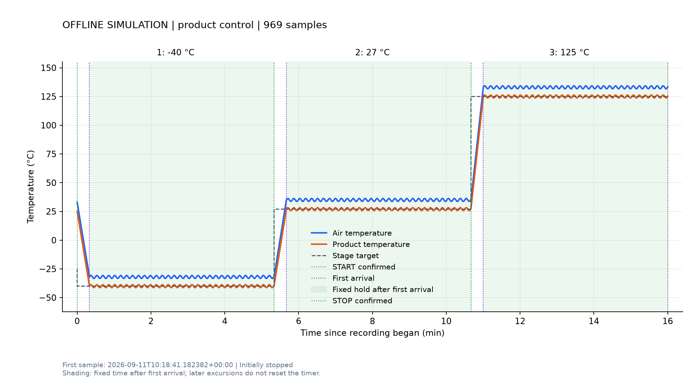

# 三阶段脚本离线验证

2026-09-11。按用户“代码验证，不必执行”的最新要求，**没有连接或控制实机**。
此目录下的温度、通信响应和停止结果来自内存模拟器，不能作为设备性能或新增接口实测证据。

## 最终结果

- 原单温度及三阶段共 **26 项测试通过**。
- 完整模拟 −40℃ → 27℃ → 125℃，每段首次到温后计时 300 秒；三段完成、模拟设备停止确认通过。
- 共记录 **969 个模拟样本，虚拟经过时间 960.282 秒**。虚拟时间加速执行，UTC 日志时间不是实际热过程时长。
- 模拟温度有意超出 ±1℃，验证计时不被重置；没有真实网络连接。
- 完整图、部分中断记录绘图及历史单阶段记录复图已检查。

| 阶段 | 模拟首次到温等待 | 固定计时实际值 | 计时期间模拟产品温度范围 | 越界样本数 |
| --- | --- | --- | --- | --- |
| −40℃ | 20.018 秒 | 300.018 秒 | −41.3～−38.7℃ | 124 |
| 27℃ | 20.018 秒 | 300.000 秒 | 25.7～28.3℃ | 124 |
| 125℃ | 20.018 秒 | 300.000 秒 | 123.7～126.3℃ | 124 |

## 模拟曲线

绿色阴影表示首次进入 ±1℃后固定计时的区间，不表示始终在温度范围内。

## 证据与复现

- [最终摘要](complete/summary.json)、[模拟 CSV](complete/temperature.csv)、[事件](complete/events.jsonl)、[模拟原始报文](complete/wire.jsonl)。
- [本次代码快照](complete/code_snapshot/thermal_stream_temperature_sequence.py)；模拟器源码也保存在同一快照目录。
- 单元测试入口：`python -m unittest discover -s scripts -p "test_thermal_stream_temperature*.py" -v`。
- `test_thermal_stream_temperature_sequence.generate_plot_fixture(Path(...))` 可在新目录重建完整模拟图。
- 自动测试将 `socket.create_connection` 替换为禁止调用的函数；真实客户端报文由内存设备解析和响应。

`attempt01_simulator_error` 与 `attempt02_summary_sharing` 是调试中间记录，均为模拟。
最终结果以 `complete` 为准。首次修正模拟温度的 0.1℃量化；随后为 Windows 短暂文件占用增加有限重试及回归测试。
这些失败过程中模拟设备的停止清理也得到确认。
