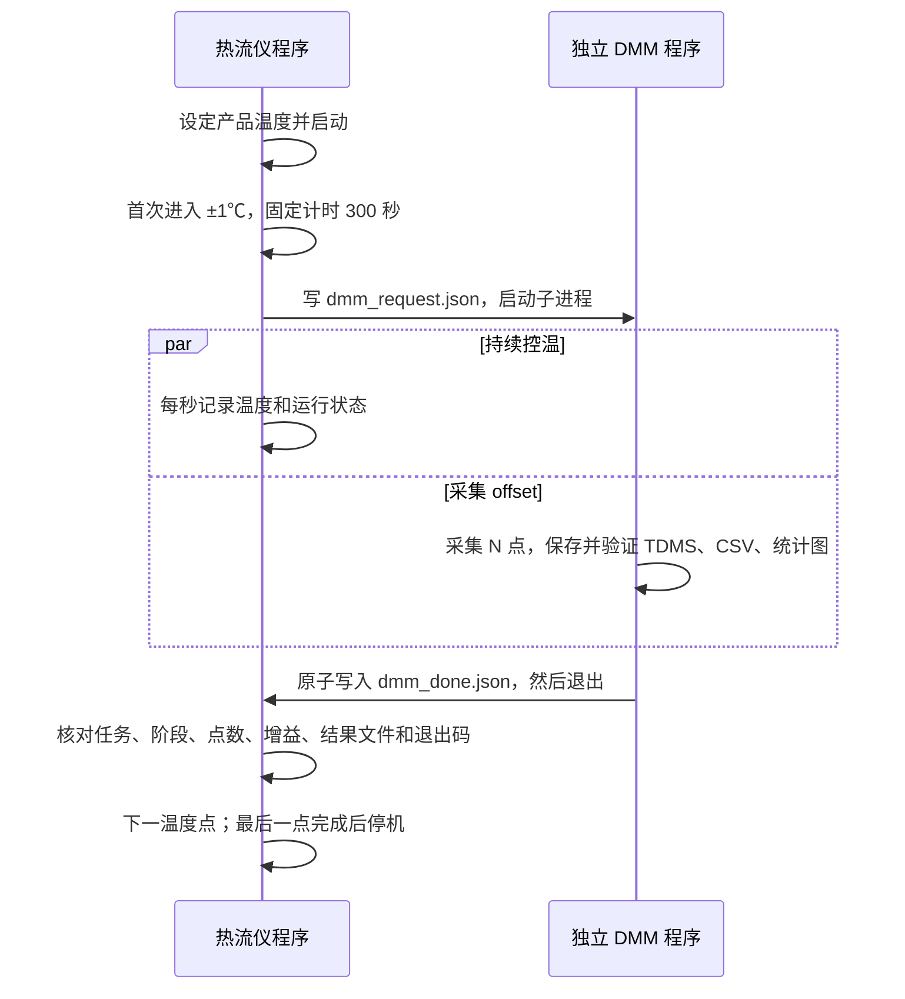

# 三温度 offset drift 联动测试

默认依次测量 −40℃、27℃、125℃。每个温度点：产品温度首次进入目标 ±1℃，固定计时 300 秒，
再启动独立 DMM7510 程序采集 **1000 点**，按 **增益 1001** 计算输入等效 offset。
热流仪在 DMM 采集期间继续控温、每秒记录温度；DMM 完成并通过结果核对后才切换温度点。
第三点完成后停止热流仪，确认 C10=0，再生成全流程温度图和 offset–温度汇总。

本次用户要求为**代码与离线验证**，没有执行联合实机测量。
2026-09-13 之前的纯热流仪实机记录曾发生连接重置；新增联动代码没有将其改为自动重连续测。
联合流程的实际效果和通信稳定性尚未验证。

2026-09-13 现场另反馈：机械臂／测试头完全不能下降，按下降按钮没有动作声，罩体无法闭合。
故障原因和升降驱动方式尚未确定；此问题排除、罩体恢复正常贴合前，应暂停联合实机温漂测试。
现有协议未提供机械臂动作、到位或腔体闭合状态，程序无法自动确认罩体闭合。
产品温度满足计时条件时，程序仍可能启动 DMM；到温判据不能代替罩体闭合检查。

## 程序分工

两程序默认在同一台 PC 上以独立进程运行，通过共享结果目录交换 JSON 文件。

| 程序 | 责任 |
| --- | --- |
| `thermal_stream_offset_drift.py` | 联动入口；复用热流仪控制流程，负责启动 DMM 子进程、核对完成标志、切温及停机 |
| `thermal_stream_temperature_sequence.py` | 串行 Modbus 请求、产品温度监测、首次到温后计时；独立运行时仍是原三阶段温度测试 |
| `dmm_offset_worker.py` | 独立进程，仅控制 DMM，采集、分析、保存结果并发布完成标志 |
| `Unicorn_CSA_RevB-COB/capture_dmm7510_offset.py` | 原 DMM 采集程序；增加可选取消检查和逐点保存回调，原独立命令仍可使用 |
| `Unicorn_CSA_RevB-COB/analyze_dmm7510_offset.py` | 原 TDMS 回读、offset 统计及绘图程序 |
| `analyze_offset_drift.py` | 汇总各温度点 offset，并关联实际温度记录 |



首次到温后的 300 秒计时沿用已确认规则：温度越界只记录，不暂停、不清零。
DMM 采集期间的温度越界也记录，不中断采集、不重复测量。完成流程不等于始终稳定在 ±1℃，
结果中的实际温度范围和越界数量用于判断本次温度条件是否足以支持 offset drift 分析。

## 运行与采样参数

在项目根目录使用已安装 PyVISA、npTDMS 1.11.0、NumPy、SciPy、Matplotlib 的 Python 3.11。
本机已核对的环境为 `C:\Users\jinge\Envs\ni-scope-2023q4\Scripts\python.exe`。

以下是**未来实机运行命令**，本轮只进行了离线验证：

```powershell
& 'C:\Users\jinge\Envs\ni-scope-2023q4\Scripts\python.exe' .\scripts\thermal_stream_offset_drift.py `
  --task-id Offset_RevB_Chip1_20260913 `
  --readings 1000 --gain 1001 `
  --tolerance 1 --hold-seconds 300 `
  --output-dir .\results\offset_drift\my_run_001
```

只运行这个入口即可；它会在各阶段等待结束后自动启动 `dmm_offset_worker.py`，无需另开 DMM 程序或手动写 flag。
当前输入接口是命令行参数，无需编辑 Python 源码。查看全部参数（不会连接仪器）：

```powershell
& 'C:\Users\jinge\Envs\ni-scope-2023q4\Scripts\python.exe' .\scripts\thermal_stream_offset_drift.py --help
```

`--task-id` 是你填写的任务／DUT 标签，例如 `Offset_RevB_Chip1_20260913`，默认 `offset`。
允许英文字母、数字、点、下划线、连字符，以字母或数字开头，不使用路径、空格、末尾点或 Windows 保留设备名。
该标签写入总记录 `summary.json` 的 `settings.task_id`、DMM 请求／进度／完成标志、
TDMS 元数据及文件名、DMM 逐点 CSV 和统计摘要，以及跨温度汇总 JSON/CSV。
三点使用相同 `task_id`，由 `stage_01`（−40℃）、`stage_02`（27℃）、`stage_03`（125℃）区分。
`run_id` 和 `job_id` 由程序自动生成，无需输入；即使重复使用同一个 `task_id`，旧 flag 也不能通过新请求的核对。

`--output-dir` 必须是尚不存在的新目录；省略时自动创建 `results/offset_drift/run_<随机ID>`，
实际路径在终端的 `OUTPUT_DIR=...` 行显示。它控制整轮测试保存位置，`--task-id` 控制任务标签及各阶段 DMM 文件名。

三个温度分别采不同点数：

```powershell
& 'C:\Users\jinge\Envs\ni-scope-2023q4\Scripts\python.exe' .\scripts\thermal_stream_offset_drift.py `
  --task-id Offset_RevB_Chip1_20260913 --readings-per-stage 500 1000 2000 --gain 1001
```

`--readings` 与 `--readings-per-stage` 二选一，每点至少 2 个读数。
热流仪保持默认 `192.168.1.50:3000`、Unit ID 0、产品控温、定值、不定时；
支持原有 `--host`、`--port`、`--unit-id`、`--interval`、`--tolerance`、`--hold-seconds`、`--stop-file` 参数。
三个温度点的模式和寄存器为 R105/C16、R104/C15、R103/C14。
温度序列目前固定为 −40℃、27℃、125℃，没有 `--temperatures` 参数。

| 热流仪／记录参数 | 默认值 | 含义 |
| --- | --- | --- |
| `--host`、`--port`、`--unit-id` | `192.168.1.50`、`3000`、`0` | 热流仪 Modbus TCP 连接 |
| `--tolerance` | 1℃ | 首次到温范围的半宽 |
| `--hold-seconds` | 300 秒 | 首次到温到触发 DMM 的固定等待时间 |
| `--interval` | 1 秒 | 温度采样周期 |
| `--output-dir` | 自动创建新目录 | 整轮记录和图表的保存目录 |

| DMM 参数 | 默认值 | 含义 |
| --- | --- | --- |
| `--readings` | 1000 | 每个温度的有效读数，另有 3 次丢弃读数 |
| `--gain` | 1001 | 输入等效 offset = DMM 电压均值 / 增益 |
| `--dmm-python` | 当前 Python | DMM 可使用不同的 Python 环境 |
| `--dmm-resource` | 自动选择唯一 USB DMM7510 | 多台设备时显式指定 VISA 地址 |
| `--terminals` | FRONT | 仅读回核对；实际前/后端子由面板选择 |
| `--dmm-range` | 0.1 V | 固定 DCV 量程 |
| `--nplc` | 10 | 复用原 DMM 配置和读回验证 |
| `--inter-reading-delay` | 0 秒 | 两个有效读数之间的额外等待 |
| `--dmm-timeout` | 60 秒 | 单次 VISA 操作超时 |
| `--dmm-max-seconds` | 3600 秒 | 每个 DMM 子进程的最大等待时间，包含配置、采集和分析；增加点数或 NPLC 时相应调整 |
| `--dmm-cancel-grace` | 5 秒 | 热流仪已尝试停机后，等待 DMM 自行退出的时间 |

沿用 AUTO 输入阻抗、Auto Zero 开启、50 Hz 工频同步、关闭 autorange、内置平均和 REL/null。
每点 DMM 配置完成后等待 2 秒并丢弃 3 次读数；它们不包含在 1000 个有效点中。
前置依赖检查不打开 VISA 连接；真正 DMM 的身份、端子和配置核对在该温度的采集进程中完成。

## 完成标志与异常

每阶段的 `dmm_request.json` 包含 `task_id`、`run_id`、`job_id`、`stage_index`、`target_c`、点数和增益等配置。
`dmm_done.json` 是完成 flag；其核心字段为：

```json
{
  "schema_version": 1,
  "status": "completed",
  "task_id": "Offset_RevB_Chip1_20260913",
  "run_id": "与请求相同的本次运行ID",
  "job_id": "与请求相同的阶段任务ID",
  "stage_index": 1,
  "target_c": -40.0,
  "request_sha256": "请求文件摘要",
  "requested_readings": 1000,
  "completed_readings": 1000,
  "gain": 1001.0
}
```

完整 flag 还包含时间和结果文件路径。它通过临时文件写入、刷新后重命名发布，读者不会读到正在写一半的 JSON。
温控程序要求 flag 成功、身份和配置匹配、点数匹配、结果文件存在、统计摘要一致，且子进程退出码为 0。
跨温度的 DMM 配置和仪器身份也必须一致。文件存在本身不足以切换温度。

失败或取消的 flag 为 `status=failed` 或 `status=cancelled`，带错误说明；子进程崩溃没有 flag、
错误/过期 flag、点数不符、采集超时均终止联动。进程仍运行时即使出现成功 flag，也不会切温。

热流仪通信失败、被外部修改配置、设备停止、进入除霜/整定，沿用原有终止行为。
程序先发出 DMM 取消请求，然后尝试热流仪 STOP 和 C10 确认，再等待 DMM 退出；
等待 DMM 不会阻碍热流仪停机。DMM 在读数之间检查取消；阻塞的 VISA 操作可能需要等超时，
超过退出等待时间时终止该子进程。已刷新到 `partial_readings.csv` 的读数保留，但不作为完成测量使用。
不自动跳段、重启或续接中断计时。

运行中按 Ctrl+C，或创建主结果目录内的 `STOP` 文件即可请求停止。
停止无法确认时，摘要保留 `stop_confirmed=false`，不能仅凭进程退出认定设备已经停止。

## 结果

```text
my_run_001/
  temperature.csv, wire.jsonl, events.jsonl, summary.json
  temperature_curve.png
  code_snapshot/
  dmm/
    stage_01/                         # stage_02、stage_03 同结构
      dmm_request.json
      dmm_progress.json
      dmm_done.json
      worker.log
      partial_readings.csv
      data/<task_id>/<task_id>_dcv_0001.tdms
      results/<task_id>/<task_id>_dcv_readings.csv
      results/<task_id>/<task_id>_dcv_offset_summary.json
      results/<task_id>/<task_id>_dcv_offset.png
  offset_drift_summary.json
  offset_vs_temperature.csv
  offset_vs_temperature.png
```

温度 CSV 的 `phase=measuring` 表示 DMM 子进程活动期间，`hold_elapsed_s` 固定为已完成的等待时间，
不会把 DMM 测量耗时继续累加为五分钟等待。温度图分别标记计时和 DMM 子进程区间。
子进程区间包括配置、输入通道等待、采集和分析；实际有效读数时间以 DMM CSV 为准。

汇总表按每段 DMM 首个到最后一个有效读数的查询中点时间，关联温度 CSV 中同阶段的样本，
保存实际产品温度均值、范围及越界数量；没有匹配样本时留空，不插值补造。
offset 图使用名义温度目标为横轴；误差棒是读数样本标准差。
三点全部完成时另给出对名义温度的一阶最小二乘斜率（V/℃），不将它作为器件规格或完整测量不确定度。
不足三个完成点时不会计算三点温漂斜率。

## 离线验证

```powershell
& 'C:\Users\jinge\Envs\ni-scope-2023q4\Scripts\python.exe' -m unittest discover -s scripts -p 'test_*.py' -v
& 'C:\Users\jinge\Envs\ni-scope-2023q4\Scripts\python.exe' .\scripts\validate_offset_drift_offline.py `
  --task-id Offline_Chip1 --readings 1000
```

离线入口固定使用内存 Modbus 设备和替换 VISA 的 DMM 模拟进程，并禁止真实网络连接。
它执行真正的独立进程握手、原 DMM 采集/分析代码、TDMS 回读校验和绘图；设备读数和时间模型为模拟。
模拟结果、图表和仪器身份均标记为 OFFLINE/SIMULATED，不能用于判断真实 DUT 温漂、到温速度或采集耗时。

2026-09-13 首次验证：34 项自动测试通过，完整三温度离线联动共采集 3000 个模拟有效点，
完成标志及最终停机均确认。详见 [离线验证记录](../results/offset_drift/offline_validation_20260913_run01/README.md)。

同日补充 `--task-id` 后，37 项自动测试全部通过；验证自定义编号贯穿实际独立进程的
1000 个模拟有效读数、TDMS 元数据、CSV、进度及完成标志，拒绝编号不符的 flag／统计摘要，
并验证原 `offset` 记录仍可汇总和绘图。详见 [当日验证报告](../docs/test-reports/2026/09/2026-09-13-T-20260911-01.md)。
